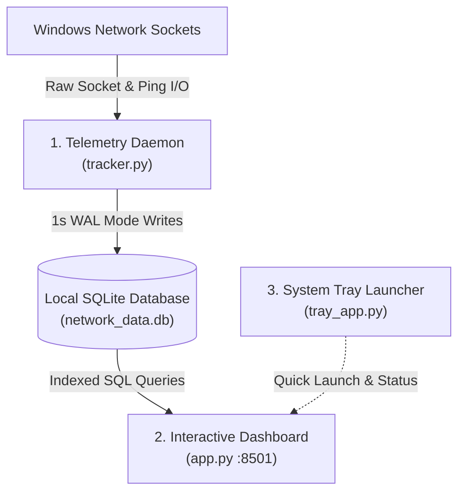

# NetPulse - Network Telemetry and Analytics Suite

NetPulse is a lightweight Windows desktop network telemetry and analytics suite designed for low system overhead, responsive visualization, and deep diagnostic insights. It continuously tracks per-interface throughput, per-process socket attribution, ICMP echo latency, and network capacity trends.

---

## Repository Structure

```text
netpulse/
├── assets/                 # Application brand icons and graphics
│   ├── favicon.png
│   └── logo.png
├── docs/                   # System design specifications and product context
│   ├── DESIGN.md
│   ├── PRODUCT.md
│   └── speedtest.md
├── scripts/                # Startup automation and build utility scripts
│   ├── build_portable.ps1
│   ├── Restart-NetworkTracker.bat
│   ├── run_tray.vbs
│   └── setup_startup.py
├── .streamlit/             # Streamlit web server and UI theme configuration
│   └── config.toml
├── analytics.py            # Statistical processing, ridge forecasting, and data modeling
├── app.py                  # Interactive dashboard interface (Streamlit and Plotly)
├── requirements.txt        # Python package dependencies
├── Start-NetPulse.bat      # One-click background launcher for end users
├── Stop-NetPulse.bat       # One-click service terminator
├── tracker.py              # High-frequency background telemetry collection daemon
├── tray_app.py             # Windows taskbar system tray indicator
├── user_settings.json      # Persistent threshold and UI preferences
├── LICENSE                 # MIT License
└── README.md               # Project documentation
```

---

## Key Capabilities

1. **Live Telemetry & Real-Time KPIs**
   - 1-second reactive telemetry fragment updating current transfer rates, session totals, and peak speeds.
   - Dual-rate Plotly waveform with Scope-Adaptive Gaussian wave smoothing and spline Bezier interpolation.
   - Machine learning anomaly detection using Isolation Forest algorithms.

2. **Per-Process Attribution**
   - Identifies and tracks network bandwidth consumption grouped by executable name.
   - Visualizes process-level time-series usage with interactive cumulative and instantaneous rate modes.
   - Export telemetry history to CSV.

3. **Diagnostics & SLA Monitoring**
   - Continuous ICMP echo ping latency tracking against user-defined SLA threshold limits.
   - Real-time packet loss calculation, jitter variance analysis, and ISP Ookla benchmark integration.

4. **Capacity & Predictive Trends**
   - Diurnal usage pattern decomposition across 4-hour temporal windows.
   - Ridge regression bandwidth forecasting calibrated against actual historical consumption.
   - Storage utilization monitoring with automated maintenance routines.

---

## Quick Start

### Option 1: Standalone Portable Bundle (Recommended for End Users)

No Python installation or command-line configuration is required.

1. Download the latest `NetPulse-v2.4-Portable.zip` from the [Releases](https://github.com/thapanon-chu/netpulse/releases) page.
2. Extract the archive to any folder on your Windows computer.
3. Double-click `Start-NetPulse.bat` to launch both the background telemetry service and the web dashboard in your default browser.
4. Double-click `Stop-NetPulse.bat` whenever you wish to shut down all background services.

> Note: All telemetry is stored locally in an isolated SQLite database (`network_data.db`) created inside your directory. No data is transmitted to external servers.

### Option 2: Running from Source (Developer Mode)

#### Prerequisites
- Windows 10 / 11
- Python 3.10 or higher
- Git

#### Installation Steps

1. Clone the repository:
   ```bash
   git clone https://github.com/thapanon-chu/netpulse.git
   cd netpulse
   ```

2. Create and activate a virtual environment (optional but recommended):
   ```bash
   python -m venv .venv
   .venv\Scripts\activate
   ```

3. Install required dependencies:
   ```bash
   pip install -r requirements.txt
   ```

4. Launch the telemetry daemon (Terminal 1):
   ```bash
   python tracker.py
   ```

5. Launch the web dashboard (Terminal 2):
   ```bash
   streamlit run app.py
   ```

6. Optional: Launch the system tray icon (Terminal 3):
   ```bash
   pythonw tray_app.py
   ```

---

## Architecture & System Design

NetPulse operates on a three-tier decoupled architecture separating high-frequency telemetry collection, persistent local storage, and real-time visualization:



| Tier | Component | Implementation | Primary Responsibilities |
| :--- | :--- | :--- | :--- |
| **1. Telemetry Daemon** | `tracker.py` | `psutil`, `socket`, `sqlite3` | High-frequency background sampling of interface throughput, process socket attribution, ICMP echo latency, and automated Ookla benchmarks; writes directly to local SQLite in WAL mode. |
| **2. Interactive Dashboard** | `app.py`, `analytics.py` | `streamlit`, `plotly`, `pandas`, `scikit-learn` | Web presentation tier on port 8501 featuring 1-second reactive KPI fragments, dual-rate Plotly waveforms with Gaussian smoothing, Isolation Forest anomaly markers, predictive Ridge forecasting, and RAM pre-fetching. |
| **3. System Tray Launcher** | `tray_app.py` | `pystray`, `Pillow` | Native Windows taskbar notification tray integration providing background status indication, one-click browser dashboard opening, and quick process management. |

### Database Isolation & Reliability
- Storage engine: SQLite operating in `WAL` (Write-Ahead Logging) mode with `PRAGMA synchronous = NORMAL`.
- Zero Shared State: The application creates a clean, independent `network_data.db` upon initial launch. The database file is excluded from version control to guarantee individual privacy and lightweight repository distribution.
- Reboot Resilience: Cumulative bandwidth metrics use monotonic non-negative delta calculations (`clip(lower=0).cumsum()`), preventing counter inversions when Windows resets network adapters.
- Downtime Gap Handling: Discontinuous intervals caused by system sleep or service interruptions are detected and rendered as true zero-level boundaries rather than misleading diagonal interpolations.

---

## Data Science & Machine Learning Pipeline

NetPulse implements statistical learning, signal processing, and time-series modeling routines in `analytics.py` to extract actionable intelligence from high-frequency telemetry.

### 1. Robust Time-Series Forecasting (Huber Loss M-Estimation)
- **Model:** `sklearn.linear_model.HuberRegressor(epsilon=1.35, alpha=1.5)`
- **Mathematical Formulation:**
  Traditional Ordinary Least Squares (OLS) regression minimizes squared error $\sum (y_i - \hat{y}_i)^2$, making it vulnerable to single-day outlier events (such as a 100+ GB bulk software download). Huber loss applies a hybrid piecewise criterion:
  $$L_\delta(r) = \begin{cases} \frac{1}{2}r^2 & \text{for } |r| \le \delta \\ \delta\left(|r| - \frac{1}{2}\delta\right) & \text{for } |r| > \delta \end{cases}$$
  Residuals smaller than threshold $\delta = 1.35$ receive quadratic penalties, while extreme burst spikes transition to linear penalties. This prevents non-stationary spikes from distorting baseline consumption projections.
- **Outlier Pre-filtering:** Data points exceeding $2.2\times$ the rolling 14-day median are dampened prior to model fitting to preserve historical trend integrity.

### 2. Time-Series Feature Engineering
- **Cyclical Trigonometric Day-of-Week Encoding:**
  $$\text{dow}_{\sin} = \sin\left(\frac{2\pi \cdot \text{dow}}{7}\right), \quad \text{dow}_{\cos} = \cos\left(\frac{2\pi \cdot \text{dow}}{7}\right)$$
  Preserves temporal continuity between Sunday and Monday in cyclical coordinate space.
- **Autoregressive Lags & Rolling Horizons:** Constructs dynamic features including `lag_1` (previous-day consumption), `roll_3` (short-term momentum), `roll_7` (weekly moving average), and `roll_14` (bi-weekly median).
- **Exponential Recency Weighting:** Samples are weighted via an exponential decay function $w_i = \exp(\text{linspace}(-1.1, 0, N))$, allocating up to $3\times$ higher priority to recent network usage patterns compared to older observations.
- **Uncertainty Quantification:** Confidence intervals ($\pm 1.28\sigma$, 80% prediction interval) are derived using Median Absolute Deviation ($\text{MAD} \times 1.4826$) for robust variance estimation.

### 3. Closed-Loop Feedback & Self-Calibrating Bias Correction
- **Automated Accuracy Auditing:** Daily predictions are logged to the `forecast_history` table in SQLite. When actual consumption data becomes available, the system evaluates:
  - **Mean Absolute Error (MAE):** $\text{MAE} = \frac{1}{n} \sum |y_i - \hat{y}_i|$
  - **Symmetric Mean Absolute Percentage Error (sMAPE):**
    $$\text{sMAPE} = \frac{100\%}{n} \sum \frac{2|y_i - \hat{y}_i|}{|y_i| + |\hat{y}_i|}$$
- **Dynamic Bias Calibration:** If a persistent directional bias ($\ge 1.0\text{ GB}$) is detected across the last 7 evaluated days, an adaptive dampening factor $\Delta_{\text{cal}} = \text{clip}(\text{rolling\_bias} \times 0.4, -5.0, 5.0)$ is automatically injected into future forecast horizons.

### 4. Unsupervised Anomaly Detection (Isolation Forest)
- **Model:** `sklearn.ensemble.IsolationForest(n_estimators=60, contamination=dynamic)`
- **Multidimensional Vector:** Evaluates 2D joint feature space $[\text{Download Rate}, \text{Upload Rate}]$.
- **Mechanism:** Isolates unusual bursts by randomly selecting feature splits. Because abnormal anomalies require fewer tree splits to isolate than normal cluster points, the continuous decision score $s(x, n)$ identifies sudden uncharacteristic saturation and anomalous network behavior.

### 5. Digital Signal Processing & Scope-Adaptive Smoothing
- **Adaptive Gaussian Convolution:**
  $$g(t) = \frac{1}{\sqrt{2\pi}\sigma} \exp\left(-\frac{t^2}{2\sigma^2}\right)$$
  The smoothing kernel standard deviation $\sigma$ adapts dynamically to the displayed temporal scope ($\sigma=8$ for responsive 1h/6h intervals, $\sigma=30$ for 24h/7d macroscopic overviews), removing high-frequency socket jitter while strictly conserving total transferred volume (integral preservation under the curve).
- **Spline Bezier Interpolation:** Employs C1 continuous cubic spline fitting over discrete 1-second samples, preventing jagged sawtooth artifacts on high-DPI displays.

---

## Settings Configuration

User preferences are persisted locally in `user_settings.json`:
- `smoothing_sec`: Waveform rolling window size (1s raw bursts, 5s responsive smoothing, 10s ultra-smooth).
- `highlight_anomalies`: Toggle machine learning anomaly markers on time-series charts.
- `chart_auto_refresh`: Configurable fragment refresh interval (`None`, `5s`, `10s`).
- `latency_sla_ms`: Target network latency threshold line.
- `packet_loss_warn_pct`: Packet loss warning alert boundary.
- `theme`: UI color palette (`dark` or `light`).

---

## License

This project is licensed under the MIT License. See the [LICENSE](LICENSE) file for details.
