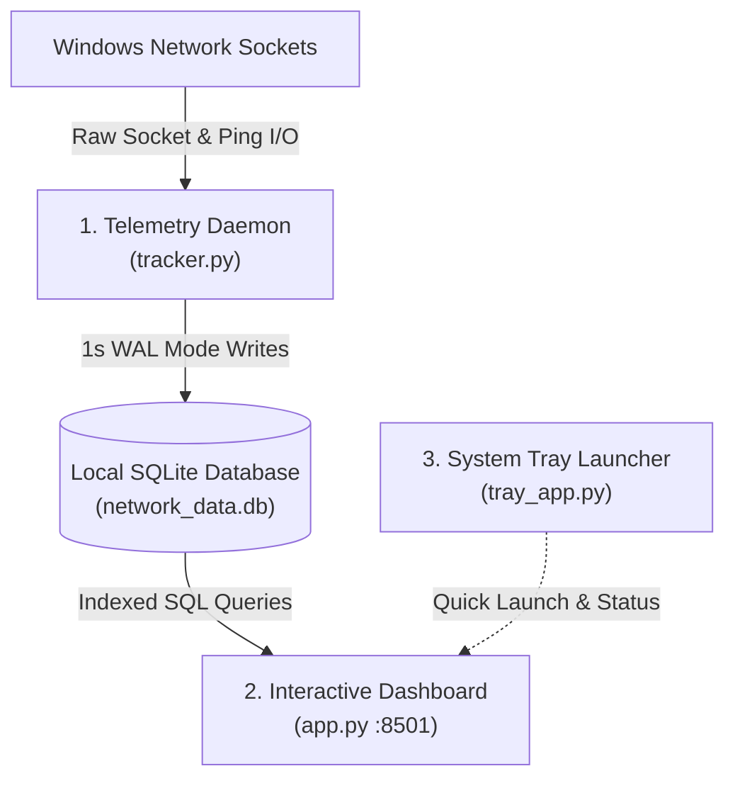
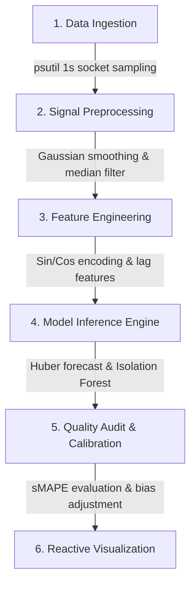

# NetPulse - Network Telemetry and Analytics Suite

NetPulse is a lightweight Windows desktop network telemetry and analytics suite designed for low system overhead, responsive visualization, and deep diagnostic insights. It continuously tracks per-interface throughput, per-process socket attribution, ICMP echo latency, and network capacity trends.

---

## Repository Structure

```text
netpulse/
├── assets/                 # Application brand icons and graphics
│   ├── favicon.png
│   └── logo.png
├── docs/                   # System design specifications and product context
│   ├── DESIGN.md
│   ├── PRODUCT.md
│   └── speedtest.md
├── scripts/                # Startup automation and build utility scripts
│   ├── build_portable.ps1
│   ├── Restart-NetworkTracker.bat
│   ├── run_tray.vbs
│   └── setup_startup.py
├── .streamlit/             # Streamlit web server and UI theme configuration
│   └── config.toml
├── analytics.py            # Statistical processing, ridge forecasting, and data modeling
├── app.py                  # Interactive dashboard interface (Streamlit and Plotly)
├── requirements.txt        # Python package dependencies
├── Start-NetPulse.bat      # One-click background launcher for end users
├── Stop-NetPulse.bat       # One-click service terminator
├── tracker.py              # High-frequency background telemetry collection daemon
├── tray_app.py             # Windows taskbar system tray indicator
├── user_settings.json      # Persistent threshold and UI preferences
├── LICENSE                 # MIT License
└── README.md               # Project documentation
```

---

## Key Capabilities

1. **Live Telemetry & Real-Time KPIs**
   - 1-second reactive telemetry fragment updating current transfer rates, session totals, and peak speeds.
   - Dual-rate Plotly waveform with Scope-Adaptive Gaussian wave smoothing and spline Bezier interpolation.
   - Machine learning anomaly detection using Isolation Forest algorithms.

2. **Per-Process Attribution**
   - Identifies and tracks network bandwidth consumption grouped by executable name.
   - Visualizes process-level time-series usage with interactive cumulative and instantaneous rate modes.
   - Export telemetry history to CSV.

3. **Diagnostics & SLA Monitoring**
   - Continuous ICMP echo ping latency tracking against user-defined SLA threshold limits.
   - Real-time packet loss calculation, jitter variance analysis, and ISP Ookla benchmark integration.

4. **Capacity & Predictive Trends**
   - Diurnal usage pattern decomposition across 4-hour temporal windows.
   - Ridge regression bandwidth forecasting calibrated against actual historical consumption.
   - Storage utilization monitoring with automated maintenance routines.

---

## Quick Start

### Option 1: Standalone Portable Bundle (Recommended for End Users)

No Python installation or command-line configuration is required.

1. Download the latest `NetPulse-v2.4-Portable.zip` from the [Releases](https://github.com/thapanon-chu/netpulse/releases) page.
2. Extract the archive to any folder on your Windows computer.
3. Double-click `Start-NetPulse.bat` to launch both the background telemetry service and the web dashboard in your default browser.
4. Double-click `Stop-NetPulse.bat` whenever you wish to shut down all background services.

> Note: All telemetry is stored locally in an isolated SQLite database (`network_data.db`) created inside your directory. No data is transmitted to external servers.

### Option 2: Running from Source (Developer Mode)

#### Prerequisites
- Windows 10 / 11
- Python 3.10 or higher
- Git

#### Installation Steps

1. Clone the repository:
   ```bash
   git clone https://github.com/thapanon-chu/netpulse.git
   cd netpulse
   ```

2. Create and activate a virtual environment (optional but recommended):
   ```bash
   python -m venv .venv
   .venv\Scripts\activate
   ```

3. Install required dependencies:
   ```bash
   pip install -r requirements.txt
   ```

4. Launch the telemetry daemon (Terminal 1):
   ```bash
   python tracker.py
   ```

5. Launch the web dashboard (Terminal 2):
   ```bash
   streamlit run app.py
   ```

6. Optional: Launch the system tray icon (Terminal 3):
   ```bash
   pythonw tray_app.py
   ```

---

## Architecture & System Design

NetPulse operates on a three-tier decoupled architecture separating high-frequency telemetry collection, persistent local storage, and real-time visualization:



| Tier | Component | Implementation | Primary Responsibilities |
| :--- | :--- | :--- | :--- |
| **1. Telemetry Daemon** | `tracker.py` | `psutil`, `socket`, `sqlite3` | High-frequency background sampling of interface throughput, process socket attribution, ICMP echo latency, and automated Ookla benchmarks; writes directly to local SQLite in WAL mode. |
| **2. Interactive Dashboard** | `app.py`, `analytics.py` | `streamlit`, `plotly`, `pandas`, `scikit-learn` | Web presentation tier on port 8501 featuring 1-second reactive KPI fragments, dual-rate Plotly waveforms with Gaussian smoothing, Isolation Forest anomaly markers, predictive Ridge forecasting, and RAM pre-fetching. |
| **3. System Tray Launcher** | `tray_app.py` | `pystray`, `Pillow` | Native Windows taskbar notification tray integration providing background status indication, one-click browser dashboard opening, and quick process management. |

### Database Isolation & Reliability
- Storage engine: SQLite operating in `WAL` (Write-Ahead Logging) mode with `PRAGMA synchronous = NORMAL`.
- Zero Shared State: The application creates a clean, independent `network_data.db` upon initial launch. The database file is excluded from version control to guarantee individual privacy and lightweight repository distribution.
- Reboot Resilience: Cumulative bandwidth metrics use monotonic non-negative delta calculations (`clip(lower=0).cumsum()`), preventing counter inversions when Windows resets network adapters.
- Downtime Gap Handling: Discontinuous intervals caused by system sleep or service interruptions are detected and rendered as true zero-level boundaries rather than misleading diagonal interpolations.

---

## Data Science & Machine Learning Pipeline

NetPulse implements specialized statistical learning, time-series modeling, and signal processing routines in `analytics.py` to convert raw socket telemetry into actionable capacity insights.



### 1. Robust Bandwidth & Capacity Forecasting
- **Algorithm:** Huber Regressor (`sklearn.linear_model.HuberRegressor`)
- **Purpose:** Projects 7-day future consumption and predicts month-end total transfer volumes to alert users before exceeding ISP data limits.
- **Working Principle:** Employs robust M-estimation that automatically balances small residual adjustments with extreme outlier absorption. Unlike standard Ordinary Least Squares (OLS) which gets heavily skewed by a single 100+ GB bulk game download, Huber loss penalizes normal variance quadratically and extreme spikes linearly. This ensures long-term monthly projections remain stable regardless of isolated burst events.
- **Outlier Dampening:** Data points exceeding 2.2x the rolling 14-day median are capped prior to training to protect baseline trajectory.

### 2. Temporal Feature Engineering
- **Techniques:** Cyclical Trigonometric Day Encoding, Autoregressive Lags, Exponential Recency Weighting
- **Purpose:** Accurately models human behavioral cycles (such as workday vs. weekend usage patterns) and evolving habits.
- **Working Principle:**
  - **Cyclical Day-of-Week:** Converts calendar days (0 to 6) into continuous sine and cosine coordinate features, allowing the model to recognize that Sunday and Monday are contiguous within a weekly cycle.
  - **Autoregressive Features:** Extracts previous-day baseline (`lag_1`), short-term momentum (`roll_3`), weekly moving average (`roll_7`), and bi-weekly median (`roll_14`).
  - **Exponential Recency Weighting:** Assigns exponentially higher weights (up to 3x) to recent days compared to older history, enabling rapid adaptation when user streaming or working schedules shift.
  - **Uncertainty Quantification:** Computes 80% confidence bands using Median Absolute Deviation (MAD) for robust variance estimation without assuming standard Gaussian error distributions.

### 3. Closed-Loop Feedback & Self-Calibration
- **Techniques:** Continuous Accuracy Auditing (sMAPE, MAE) and Dynamic Residual Compensation
- **Purpose:** Tracks historical forecast accuracy against actual observed consumption and self-corrects systematic model drift without requiring manual retraining.
- **Working Principle:** Every prediction is persisted in an internal SQLite table (`forecast_history`). When actual daily telemetry accumulates, the engine computes Mean Absolute Error (MAE) and Symmetric Mean Absolute Percentage Error (sMAPE). If a consistent directional bias (1+ GB) is detected over the past 7 evaluated days, an adaptive compensation factor is dynamically injected into future prediction horizons.

### 4. Real-Time Network Anomaly Detection
- **Algorithm:** Isolation Forest (`sklearn.ensemble.IsolationForest`)
- **Purpose:** Automatically identifies uncharacteristic bandwidth spikes, stealth background uploads, or abnormal socket saturation on live charts.
- **Working Principle:** Evaluates joint 2D socket vectors (Download Rate vs. Upload Rate). Rather than modeling normal density, Isolation Forest isolates anomalies by randomly partitioning feature space. Because extreme or suspicious bursts require significantly fewer tree splits to isolate than normal cluster points, the model computes decision scores and automatically highlights high-severity outlier events.

### 5. Digital Signal Processing & Scope-Adaptive Smoothing
- **Techniques:** Scope-Adaptive Gaussian Kernel Convolution and Spline Bezier Interpolation
- **Purpose:** Filters out high-frequency socket counter noise to produce clean, intuitive waveforms while strictly preserving exact transfer volume.
- **Working Principle:**
  - **Adaptive Gaussian Convolution:** Automatically scales the smoothing window and standard deviation according to the selected view (narrow kernel for responsive 1-hour inspection, wider kernel for 7-day trend analysis). Total area under the curve is strictly conserved so cumulative transfer statistics remain 100% accurate.
  - **Downtime Gap Handling:** Detects system sleep or daemon interruptions (intervals exceeding 3.5x the median step) and grounds curves to zero rather than drawing misleading diagonal interpolation lines across hours of downtime.

---

## Settings Configuration

User preferences are persisted locally in `user_settings.json`:
- `smoothing_sec`: Waveform rolling window size (1s raw bursts, 5s responsive smoothing, 10s ultra-smooth).
- `highlight_anomalies`: Toggle machine learning anomaly markers on time-series charts.
- `chart_auto_refresh`: Configurable fragment refresh interval (`None`, `5s`, `10s`).
- `latency_sla_ms`: Target network latency threshold line.
- `packet_loss_warn_pct`: Packet loss warning alert boundary.
- `theme`: UI color palette (`dark` or `light`).

---

## License

This project is licensed under the MIT License. See the [LICENSE](LICENSE) file for details.
